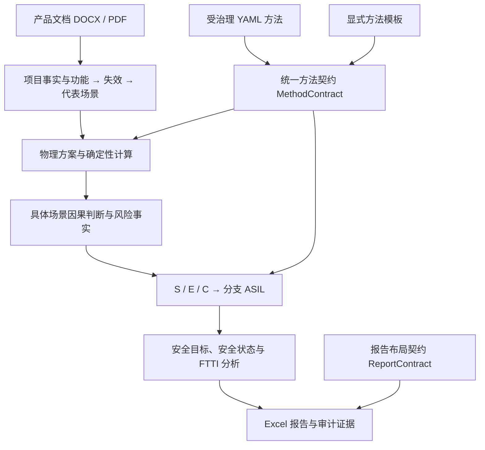

# HARA V13

**从产品定义到可追溯的 HARA 工程分析与 Excel 报告。**

HARA V13 面向车辆功能的危险分析与风险评估（HARA）。系统读取 DOCX 或 PDF 中的功能、
边界与运行条件，构建失效和代表场景，完成物理分析、因果判断及风险计算，
输出供工程审核使用的报告与计算证据。

[快速开始](#快速开始) · [五份固定输入](#五份固定输入) · [报告与验证现状](#报告与验证现状) · [技术文档](#技术文档) · [开发与验证](#开发与验证)

## 主要能力

| 环节 | 处理内容 |
|---|---|
| 来源提取 | 提取功能、输出、速度范围、运行阶段与前提，保留原文位置、限定和否定条件 |
| 场景构建 | 结合项目运行范围、方法条件及失效机制，生成有界的代表工况与驾驶员分支 |
| 自主物理分析 | 为需要补全的工况提出对象、运动模型和点值、范围或符号假设，由程序校验并计算 |
| 因果与风险 | 判断具体失效是否导致危险，执行活动方法中的 S/E/C 规则和 ASIL 矩阵 |
| 安全目标与时间分析 | 关联 Safety Goal（安全目标）、Safe State（安全状态）及 FTTI 响应时间分析 |
| 报告与运行证据 | 按模板生成 Excel，保留成员关联、来源与风险追踪，支持缓存、请求账本和断点恢复 |

S、E、C 分别表示严重度、暴露度和可控性。**计算数值、分析假设与工程批准分别记录。**
合理的动态假设可以形成条件性结果；未知产品规格和方法范围缺口会说明各自影响的结论。

## 工作流程与输入分工



三类资料各有职责：

- **产品文档**提供当前项目的事实、功能和运行范围。
- **方法来源**提供场景条件、物理与评分规则，编译为同一个 `MethodContract`。
- **报告模板与展示配置**提供表格结构、字段和样式。

LLM 负责有来源的语义判断和分析假设；Python 负责结构与物理约束校验、确定性计算和方法执行。
已有来源或代表规则足够时沿用现有路径，需要补全时才调度有界的物理任务。
完整流程、代码实例及各阶段输入输出见[可视化工作流详解](docs/handover/HARA_Workflow_Engineering_Detail_20261124.html)。

## 五份固定输入

仓库已包含以下五份原始输入，可分别通过 `--item` 选择：

| 项目 | 文件 | 内容 |
|---|---|---|
| AVP | [input/ItemDef.docx](input/ItemDef.docx) | 原 AVP Item Definition |
| IPA-High | [input/FSB_IPA-High_2.2.pdf](input/FSB_IPA-High_2.2.pdf) | IPA-High 2.2 功能规格 |
| IPA-Main | [input/FSB_IPA-Main_2.2.pdf](input/FSB_IPA-Main_2.2.pdf) | IPA-Main 2.2 功能规格 |
| RPA | [input/FSB_RPA-High_2.2.pdf](input/FSB_RPA-High_2.2.pdf) | RPA-High 2.2 功能规格 |
| rTPA | [input/FSB_rTPA-High_2.2.pdf](input/FSB_rTPA-High_2.2.pdf) | rTPA-High 2.2 功能规格 |

每份文件作为独立项目输入使用。运行模式应按对应原文选择，训练、搜索和执行阶段的条件分别处理。
新项目使用独立输入路径、Run ID 和输出文件。

文件 SHA256、生产读取器检查、冻结夹具和历史结果复现说明统一见
[输入与测试资产说明](input/README.md)。当前文档读取器支持 DOCX 和有文本层的 PDF。

## 快速开始

以下命令在仓库根目录执行，使用 Python 3.12 和 macOS/Linux 路径。
平台约束、完整参数及运行配置见[部署、配置、运行与恢复](docs/handover/05_部署配置运行与恢复.md)。

### 1. 安装

```bash
python3.12 -m venv .venv
.venv/bin/python -m pip install -e ".[test]"
.venv/bin/python -m hara_agent --help
```

安装后的命令行入口为 `hara-agent`，也可继续使用 `python -m hara_agent`。

### 2. 配置模型服务

在本地 `.env` 中填写服务信息。以下为占位示例：

```dotenv
HARA_LLM_PROVIDER=openai-compatible
HARA_LLM_BASE_URL=https://YOUR_PROVIDER_ENDPOINT
HARA_LLM_MODEL=YOUR_MODEL_OR_ENDPOINT_ID
HARA_LLM_API_KEY=YOUR_API_KEY
```

支持的 Provider 类型为 `openai-compatible` 和 `volcengine-agent-plan`；按实际接口选择。
CLI 读取当前目录的 `.env`，已存在的进程环境变量优先。密钥与个人配置保留在本地。
思考模式、超时和重试选项见部署手册，示例不覆盖这些阶段配置。

### 3. 检查方法、模板和配置

```bash
.venv/bin/python -m hara_agent doctor \
  --method-baseline method_assets/fusa_baseline_v1/manifest.yaml \
  --report-template references/HARA_Template_AI_20260327.xlsx
```

`doctor` 不发送模型请求，检查方法编译、报告契约和本地 LLM 配置。
缺少 API 配置时会单独报告该项未就绪；账户额度及真实连通性由实际请求验证。

### 4. 执行分析

先替换运行模式占位符，并为新运行选择唯一 Run ID 和输出路径。以下命令会调用模型服务：

```bash
.venv/bin/python -m hara_agent analyze \
  --item input/ItemDef.docx \
  --method-baseline method_assets/fusa_baseline_v1/manifest.yaml \
  --report-template references/HARA_Template_AI_20260327.xlsx \
  --output output/HARA_Report.xlsx \
  --run-id project-run-001 \
  --operating-mode "<输入文档中的实际运行模式>" \
  --max-workers 8 \
  --allow-draft
```

`--allow-draft` 允许保留待审核状态输出草稿。普通分析默认并发为 8；
有界样本的范围、请求上限和并发要求见部署手册。

显式使用 Excel 模板作为方法来源时，将 `--method-baseline` 和 `--report-template`
替换为 `--template TEMPLATE.xlsx`。方法角色存在歧义时，用 `confirm-template-role`
保存与模板哈希绑定的确认记录。

### 5. 查看进度与恢复

终端输出当前处理阶段；默认运行状态与响应缓存位于 `runtime/agent/`，
审核和计算追踪位于 `runtime/review/`。恢复时使用原命令及 Run ID，增加 `--resume`，
保留相同输入、方法、运行范围和相关配置。详细日志、账本及历史报告重导方法见部署手册。

## 报告与验证现状

Excel 保留报告模板格式，并通过稳定身份关联主表、成员、分支和安全目标。

| 工作表 | 审核内容 |
|---|---|
| `04_HARA` | 工况、危险事件、完整 S/E/C/ASIL 元组、评级依据及 SG、状态、FTTI 关联 |
| `04A_Scenario Detail` | 具体成员的物理条件、关键假设、参数、分支与计算结果 |
| `05_Method Basis` | 活动方法、适用范围及规则依据 |
| `06_Safety Goal` | 安全意图、关联成员、最高已知等级及安全状态与时间信息 |
| `99_Audit` | 来源、哈希、审核状态、完整追踪与身份映射 |

主表按失效、工况和完整评级等条件组织审核组，每行展示一组 S/E/C/ASIL；关联成员保留在明细中。
场景数量、实际 Provider 请求数和主表行数分别统计。精确任务复用、物理方案复用、共同证据共享
和完整因果复用也分别记录，以实际请求和 Token 衡量运行成本。

**当前结果基准为 2026-11-23 的五份完整修订报告。** 五份输入均有历史真实分析及后续定向修订。
各项目的风险数量、评级完成情况、调用成本和具体缺口见
[验证结果与已知限制](docs/handover/07_验证结果与已知限制.md)。仍有 C 方法适用范围、
响应控制路径、FTTI、场景覆盖及工程审核方面的未决项，结果用于相应范围内的工程评审。

阅读时应区分“已有条件性数值、待审核”和“尚无数值、待评定”。
FTTI 还需结合适用响应、时间起点和避碰结果理解；具体语义见
[SG、安全状态、FTTI 与报告](docs/handover/04_SG安全状态FTTI与报告.md)。

代码、五份固定输入、方法、报告模板和离线测试资产随 Git 交付。
`output/`、`runtime/` 中的历史 Excel、checkpoint、原始响应和账本通过独立证据包移交；
其路径、版本和校验方式见[资产移交清单](docs/handover/08_资产移交与接手清单.md)。

## 技术文档

| 文档 | 内容 |
|---|---|
| [开发与技术交接手册](docs/handover/README.md) | 架构、数据、算法、运行、测试和当前结果的总入口 |
| [可视化工作流详解](docs/handover/HARA_Workflow_Engineering_Detail_20261124.html) | 13 步生产流程、关系图、代码实例与源码索引；下载后用浏览器离线阅读 |
| [输入抽取、数据契约与方法治理](docs/handover/02_输入抽取数据契约与方法治理.md) | 来源、功能抽取、项目作用域及方法编译 |
| [场景、物理与风险计算](docs/handover/03_场景物理与风险计算.md) | 场景展开、物理推导、因果、评分及复用条件 |
| [部署、配置、运行与恢复](docs/handover/05_部署配置运行与恢复.md) | 安装、配置、CLI、预算、监控与恢复 |
| [开发、测试与维护](docs/handover/06_开发测试与维护.md) | 代码职责、测试选择、回归与交付要求 |
| [文档索引](docs/README.md) | 当前说明、历史开发记录及清理核查的用途与入口 |

## 代码与资产布局

```text
input/                             五份固定输入、校验值与复现说明
src/hara_agent/application.py      普通生产应用入口
src/hara_agent/cli.py              命令行参数与命令装配
src/hara_agent/template/           Excel 方法角色发现与编译
src/hara_agent/method_sources/     受治理 YAML 方法编译
src/hara_agent/contracts/          类型契约与规则表示
src/hara_agent/services/extraction/ 来源提取与规范化
src/hara_agent/services/semantic/  有界语义任务
src/hara_agent/services/analysis/  物理、方法执行与事实绑定
src/hara_agent/services/reporting/ 报告投影与模板渲染
src/hara_agent/infrastructure/     Provider、预算、缓存与文件适配
src/hara_agent/workflow/           调度、检查点与质量检查
method_assets/                    受版本管理的方法资产
references/                       报告模板及角色基线
report_assets/                    报告展示配置
tests/                            离线测试与冻结夹具
skills/                           项目阶段操作规范
docs/                             技术手册与历史证据记录
```

## 开发与验证

默认测试使用离线响应和固定夹具，无需 API key。交付前运行：

```bash
.venv/bin/python -m pytest -q
.venv/bin/python -m compileall -q src scripts
.venv/bin/python -m hara_agent doctor \
  --method-baseline method_assets/fusa_baseline_v1/manifest.yaml \
  --report-template references/HARA_Template_AI_20260327.xlsx
git diff --check
```

离线回归、历史运行证据检查与新真实 Provider 验证分别记录。新付费请求使用当轮有效授权。
维护约束以 [AGENTS.md](AGENTS.md)、[项目技能入口](SKILL.md)、活动输入与编译契约为准。
修改优先落在现有权威实现及其生产调用链，保留数值、来源、审核、身份与恢复行为的可追溯性。
