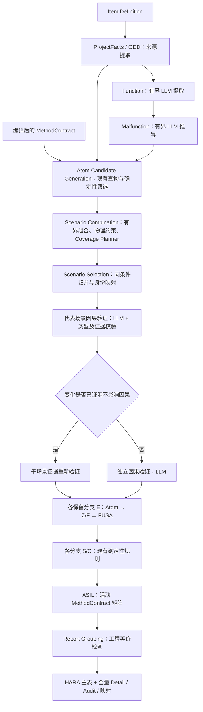

# P6：场景生成、Exposure 与冗余分析修复

日期：2026-10-12。开发与验证均为离线；实际 Provider 请求、重试和 Token 均为 0。

## 1. 审核结论与执行范围

P6 的主链修复方向成立，已接入普通 `analyze`，不是只修历史 Excel 或增加旁路工具。使用现有场景合成器、约束检查器、因果证据验证器和 FUSA 评分器，没有改动方法资产中的 E 值、S/C 算法或 ASIL 矩阵。

历史 `full-p5o-20261010-001` 的 checkpoint、风险结果与报告保留。新候选不能继承旧场景的因果批准；本次全数据回放统计的是新候选和确定性 E 试算，正式风险写入路径另外通过 Mock 集成测试验证。

没有新增人工逐 Atom 审批、场景组合签字或发布门槛。已通过方法验证的分析条件使用 `SCENARIO_DEFINED`，与原文项目事实分开。

## 2. 根因及修复

| 根因 | 修改后的行为 |
|---|---|
| 普通 analyze 只产生 Item 词语的精确绑定和模板物理变体，已有有界 Atom 合成器未接入 | `generate_for_malfunction()` 在因果分析前调用已有语义查询、shortlist、Coverage Planner、组合验证和 materialize |
| 复合 Atom 用一个分数与多个独立 Atom 的累加分竞争 | 按覆盖维度累计已有排名分；不读取 E 等级排序 |
| 倒车方向覆盖了标签中的泊车动作信息 | 保留泊车语义，同时记录倒车方向 |
| 一部分 Atom 的速度只写在规范标签中，未编译成结构化范围 | YAML 编译器读取明确的不等式，包含开闭边界；范围有多解时不代选。编译器版本升为 v2 |
| materialize 将 canonical ID 写入实际评分 Atom 集，而 binding 保留原始 ID | 评分使用实际 catalog ID；canonical ID 保留为跨版本引用 |
| Atom 标签可能继承父场景项目事实的 provenance，动作还覆盖车辆激活状态 | 复用分析场景证据投影；新增动作字段 `ego_action`，保留 `vehicle_state`；选定 Atom 标签标为已验证、限于本场景的分析条件 |
| 同样的结构化条件在多个父锚点下重复生成 | 在同一 Malfunction 内按实际条件及事实来源状态归并，保留全部原始身份及代表映射 |
| 驾驶员分支重复做完整因果判断 | 先分析代表分支；仅在依赖声明证明不干涉时复用，并使用子场景的证据 registry 重新编译、验证因果结果。相关分支独立分析 |
| E preview 对多候选歧义直接阻塞，且单维度不变被误当成联合不变 | 多候选结果相同允许通过；多个缺失维度执行联合试算，使用原评分器。联合证明最多检查 256 个组合，超出时保留具体未决原因 |
| E preview 将与已选动作冲突的复合 Atom 加入当前世界，制造 E 变化证据 | 只检查维度不冲突的合法补全。不会以替换当前动作的另一个世界阻塞当前 E |
| 归并前候选写入 append-only 审计后，可能占用代表身份或放大预计待分析数 | 原始别名候选与最终代表分别持久化；预期因果数量取最终实例，保留动作、方向、驾驶员和来源属性 |
| 主表分组缺少足够工程等价条件 | P6 主表仅归并条件、已验证因果、危险事件、伤害机制、评分、域和 SG 一致的完整结果；未证明等价者分别显示 |

### 核心文件与函数

- `src/hara_agent/application.py`：`_preview_bounded_scope()` 使用同一生产候选路径。
- `src/hara_agent/workflow/nodes/scenarios.py`：`assess_scenarios()`、`_assess_instantiated_scenarios()`；缓存版本更新，保存复用审计与真实调用统计。
- `src/hara_agent/services/analysis/method_scenario_service.py`：`generate_for_malfunction()`。
- `src/hara_agent/services/analysis/scenario_method_service.py`：`instantiate_analytical_candidates()` 支持暂不展开驾驶员。
- `src/hara_agent/services/analysis/scenario_synthesis_service.py`：`generate_candidates()`、`materialize()`、`project_validated_atom_facts()`、速度边界和组合排名。
- `src/hara_agent/services/analysis/scenario_selection_quality.py`：`ScenarioCandidateRanker.atom_category_sources()`。
- `src/hara_agent/services/analysis/scenario_equivalence.py`：条件签名、同条件归并、驾驶员分组和复用证明。
- `src/hara_agent/services/analysis/exposure_input_readiness_service.py`：合法补全、同值歧义、联合试算及域错误分类。
- `src/hara_agent/method_sources/yaml_baseline.py`：`_explicit_label_speed_range()` 与编译器版本。
- `src/hara_agent/services/semantic/scenario_agent.py`、`scenario_batching.py`、`models/scenario.py`：可选且有类型边界的因果依赖声明；缺失声明只影响复用，不阻塞正常独立分析。
- `src/hara_agent/workflow/scenario_causal_revalidation.py`：与主链共用分析条件事实投影。
- `src/hara_agent/workflow/review_artifacts.py`：代表数量与完整来源审计。
- `src/hara_agent/services/reporting/projection.py`：工程条件分组及 `grouping_map`。
- `scripts/benchmark_p6_offline.py`：回放上述生产服务、检查历史证据、生成可复核统计；不创建 Provider。

上一轮对 schema 修复重试、历史计数、V1/V2 readiness 和报告字段的修改已保留。开发前差异保存于 `output/p6/pre_p6_changes.patch`。

## 3. 新执行链路

驾驶员子身份仍在候选阶段保留；不先给每个身份重复调用模型。C 和 ASIL 始终逐分支计算。复用范围是同一 Malfunction 内相同非驾驶员条件、且具有明确无干涉证明的分支；不同对象、运动方向或物理条件不自动共享整条因果链。

## 4. 全数据离线比较

证据：`output/p6/summary.json`、`historical_audit.json`、`generation_audit.json`、`candidate_previews.json`。

### 场景与风险

| 指标 | 历史 P5-O | P6 离线回放 |
|---|---:|---:|
| Function / Malfunction | 9 / 58 | 同一批已提取输入 |
| 父上下文锚点 | 13 | 13 |
| 父 Atom 为空 | 13/13 | 父锚点仍是来源上下文；在下游生成具体 Atom 世界 |
| 驾驶员展开前 | 1,105 | 3,315 个原始合成候选 → 255 个同条件代表 |
| 驾驶员展开后候选关联 | 2,210 | 510 |
| Atom 非空 | 0/2,210 | 510/510（100%） |
| 方法约束验证 | 原历史数据未按新合成路径验证 | 510/510（100%；不等于新的因果通过率） |
| E 输入就绪、可确定试算 | 0/1,605 风险记录 | 510/510 候选（100%） |
| 正式写入 E FINALIZED | 0 | 本次全数据回放未写入新风险；Mock 主链测试已验证该路径 |
| E 未就绪根因 | 1,605：Atom 集为空 | 0；合法补全试算均未改变当前 E |
| S FINALIZED | 752/1,605（411 S1、341 S2） | 新候选未重做完整因果与评分；历史值保留 |
| C / ASIL FINALIZED | 0 / 0 | 新全量未验证 |
| 独立危险事件数 | 不能由 1,605 条风险行直接推定 | 需新因果结果，不能用 255/510 候选数代替 |

510 个就绪 E 试算值：E1=28、E2=122、E3=276、E4=84。初版回放曾有 60 个 E 阻塞，合法复合 Atom 补全检查修复后消除；这些试算均未冒充历史 run 的正式结果。

### 七维状态

| 维度 | RESOLVED | NOT_APPLICABLE | 未绑定但已证明不改变当前 E |
|---|---:|---:|---:|
| WHERE | 510 | 0 | 0 |
| ROAD | 510 | 0 | 0 |
| EGO_ACTION | 510 | 0 | 0 |
| EGO_DYNAMICS | 510 | 0 | 0 |
| EGO_X_ROAD | 6 | 504 | 0 |
| TRAFFIC_PATTERN | 20 | 390 | 100 |
| OBJECT | 222 | 288 | 0 |

**覆盖边界：** 当前有界计划以动作、动力学与模板物理选项为主要变化轴；本次选中的 WHERE 均为 `CN_parking_multistory`。这证明了主链能够产生可计算候选，不能证明已穷尽室内、室外、全部车位几何或所有独立危险事件。候选池及过滤原因完整保存，场景数量下降不作为覆盖充分的证明。

### 重复与模型效率

历史审计使用保存的结构化 review 输入，并补回明确的驾驶员分支身份；缺少 Atom 和因果依赖声明的旧场景不被追认为工程等价。

- 完全重复分析身份：0；同一 MF 下相同已保存结构化输入冗余：0。
- 忽略驾驶员后的历史输入组：1,105；潜在可共享分支：1,105，历史证明通过数为 0。
- 忽略环境/驾驶员后的物理条件相似组：85，潜在共同故障行为关联 2,125；仅作为复核线索，未据此删除危险事件。
- 同一结构化世界出现在多个 MF 的分组：156；不跨 MF 复用因果结论。
- P6 同条件候选归并：3,060 个重复实例，所有原始身份保留。
- P6 驾驶员组：255；理论可复用 255 个分支，是否实际命中取决于新依赖证据。实际独立语义分析规模尚未测得。
- Mock 证明：两分支无干涉时，1 个代表分析 + 1 个子证据验证；驾驶员影响因果时，2 个独立分析。不是实际 Provider 成本节省测量。

| 指标 | 历史因果阶段（按 MF 最新事件去重） | 本次离线开发 |
|---|---:|---:|
| Provider 请求 | 2,519 | 0 |
| 重试 | 9 | 0 |
| 输入 Token | 12,480,004 | 0 |
| 输出 Token | 1,065,982 | 0 |
| 真实新运行复用命中率 | 无相应元数据 | 未测量 |

### 报告

重新打开修正版 Excel 核实：HARA 1,605 行，Scenario Detail 1,605 行，Audit 2,210 行；58 个 MF 的历史修复保留。

P6 报告测试中，3 条已证明等价的完整风险记录归并为 1 行，3 条详情、3 个审计引用和全部 assessment/scenario ID 均保留。改变运动方向、驾驶员/C、伤害、因果路径，或存在 Pending 时，分别保留。真实 P6 全量主表行数尚未产生，不将测试夹具的 3→1 当作真实压缩比例。

## 5. 测试和验收

最终：`749 passed, 1 skipped`，无失败，耗时 72.07 秒。

- `.venv/bin/python -m pytest -q`：通过。
- `.venv/bin/python -m compileall -q src scripts`：通过。
- `git diff --check`：通过。
- `doctor --method-baseline method_assets/fusa_baseline_v1/manifest.yaml --report-template references/HARA_Template_AI_20260327.xlsx`：通过；无 blocking diagnostic。
- 跳过项：默认不启用的 `test_historical_scenario_guard.py`（需要 `HARA_RUN_HISTORICAL_GUARDS=1`）。
- 真实 Provider 集成测试：本轮未执行，与上述 skip 分开记录。

| 验收项 | 证据 |
|---|---|
| A 泊车动作生成 | `test_a_b_c_parking_candidates_are_bounded_and_have_method_atoms` |
| B 0–7 和开边界 | 上述测试及 `test_b_open_speed_boundary_is_not_a_valid_intersection` |
| C 高速排除 | A/B/C 测试检查所选全部 Atom 与 ODD 范围的兼容性 |
| D V1/V2、E 主链 | `test_d_e_generated_raw_atom_identity_reaches_native_e_scoring` |
| E 正式评分节点 | `test_ordinary_scenario_node_generates_atoms_before_causal_agent` |
| F 无关空维度、联合与复合约束 | `test_exposure_input_readiness.py` 的新增 P6 测试 |
| G FUSA 聚合不变 | 五组原生聚合回归及现有结构化评分测试 |
| H 同条件归并 | `test_h_exact_conditions_coalesce_with_complete_identity_map`，来源状态不同不归并 |
| I 有条件驾驶员复用 | `test_h_i_driver_causal_reuse_is_conditional_and_revalidates_child` |
| J/K 防误合并与身份保存 | `test_reviewer_report_closure.py` 的新增 P6 测试及主链持久化检查 |
| L S/C/ASIL 不受因果复用影响 | `test_l_causal_reuse_does_not_reuse_c_or_asil_ratings`：共享因果后仍分别得到 C1/C3 和不同 ASIL；完整既有数值回归通过 |

## 6. 尚未闭环的事项

1. **代码覆盖策略局限**：当前有界计划不证明所有 ODD 环境和车位几何已覆盖；WHERE 的单一选择见上表。更宽的因果部分步骤复用尚未自动实施；本轮优先完成同条件归并和有证明的驾驶员复用。没有用“同 MF”或文字相似跳过不同危险机制。
2. **工程事实缺失**：新候选中 102 个具有方法明确的 REVERSE 方向，408 个没有可采用的明确纵向方向。0–7 km/h 是范围，不能代替事件点速度、闭合速度或碰撞参数，因此不能承诺下次全量 S/C 全部完成。
3. **方法能力边界**：doctor 仍报告既有的 `BASELINE_SCENARIO_BINDING_INCOMPLETE`、`FTTI_METHOD_UNCOMPILED`、`SEVERITY_FALLBACK_UNCOMPILED` 警告；未新增默认值或另一个评分引擎掩盖它们。
4. **工程审核与新语义验证**：需要检查新因果结果及代表场景对独立危险事件的覆盖。无需逐 Atom 人工批准；只有真正无法由现有依据确定的工程语义才需要确认。

这轮修复已进入本地代码，下次新建 `analyze` 会使用。对已完成历史 run 执行 `--resume` 不会自动重建候选；新运行命令见 README 的 P6 节。没有自动发起付费全量，也没有提交或推送代码。

## 7. 证据与完整性

- 当前 Method 源 hash：`907ed1cfaf7557941d746b84c2d1d10f801716ba87a2200a9841c5efc702830d`；资产未改动。
- 原 checkpoint SHA256：`0427c6967413995274dbe7112be00deb6286c4194d4bd64f759bea77851d0317`，回放前后相同。
- 历史风险 trace、场景缺口、模板选取和修正版 Excel 的文件 hash 记录于 `output/p6/historical_audit.json`。
- 输出路径：`output/p6/`；完整测试与 doctor 输出另存于该目录。
