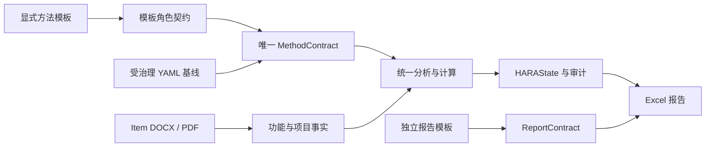
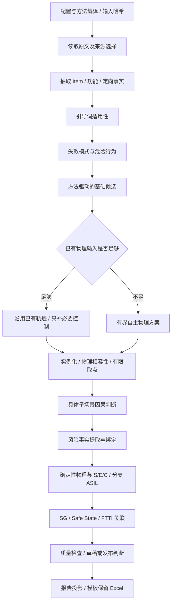

# 01　架构与端到端流程

> 交接基线：`d6a400e7010d62ff5dda56efd8215f23729bb3ec`；核对日期：2026-11-24。本文描述已经存在的代码，不是待开发架构。返回[交接总览](README.md)。

## 1. 系统解决什么问题

HARA Agent 把产品定义中的功能、运行范围和约束，与经过治理的 HARA 方法结合，形成可追溯的危险分析、风险评级、安全目标和 Excel 审核材料。它既不是让 LLM 直接填写整张 HARA 表，也不是只把一个参考项目的数值复制到新项目。

整个系统有三种职责：

| 职责 | 实际内容 | 主要实现 |
|---|---|---|
| 语义理解 | 提取功能和来源事实，判断引导词适用性，提出故障与危险行为、物理假设和因果解释 | `services/semantic/` |
| 工程计算 | 检查输入相容性，计算运动、接触与响应，执行活动方法中的 S/E/C 和 ASIL | `services/analysis/`、编译后的 `MethodContract` |
| 编排与交付 | 选择任务、限制预算、复用结果、保存状态、记录证据、投影与生成 Excel | `application.py`、`workflow/`、`infrastructure/llm/`、`services/reporting/` |

有数值不等于完成工程批准。系统允许对清楚标识的假设进行条件性计算；`PENDING` 可以是“已有数值但待审核”，也可以是“缺少计算条件而没有数值”。两者在数据和报告中都需要分开。

## 2. 三类输入、一个方法契约



- **产品输入**说明“本项目是什么、允许做什么、有哪些限制”。不携带默认评分权威。
- **方法输入**说明“如何选择工况、如何计算和判定”。来自显式模板或 YAML 基线，最后都编译成同一个 `MethodContract`。
- **报告模板**说明“结果放在哪里、如何保留工作簿格式”。在 YAML 路径下，它与方法资产是两个独立哈希。

[`MethodSourceResolver.resolve()`](../../src/hara_agent/method_sources/resolver.py)是两条方法来源的汇合点。传入 `template_path` 时走模板方法；未传入时，先编译报告模板布局，再编译 YAML 基线。不能把 `--report-template` 误认为显式选择模板作为评分方法。

当前实现复用完整模板编译器校验报告模板，并检查其工程规则编译就绪，然后仅把 `ReportContract`交给 YAML 编译器。因此最终评分权威仍是 YAML，但**只有布局的任意空工作簿不保证通过现有报告模板预检**；替换模板须实际运行 doctor。

## 3. 唯一生产入口与真实执行顺序

入口为 [`cli.py`](../../src/hara_agent/cli.py) → [`HARAApplication.run()`](../../src/hara_agent/application.py) → [`build_hara_agent_graph()`](../../src/hara_agent/workflow/semantic_graph.py)。`python -m hara_agent` 与安装后的 `hara-agent` 指向同一应用。



**当前自主物理场景构建通常发生在具体因果判断之前。** 基础候选已经有方法条件，但需要把对象、轨迹、阶段、参数和控制能力落实后，因果 Agent 才能评价具体世界。评分阶段还会执行或复核确定性推导。它不是“先完成所有因果，再另起一个物理系统”。

源码关键接点：

| 接点 | 核心职责 |
|---|---|
| [`application.py`](../../src/hara_agent/application.py) | 方法解析、输入 SHA256、配置校验、候选服务、Agent、评分服务、renderer 与 checkpoint 依赖组装 |
| [`semantic_graph.py`](../../src/hara_agent/workflow/semantic_graph.py) | 复用前端图及完整图；样本只选择范围，不替换策略 |
| [`nodes/item_artifacts.py`](../../src/hara_agent/workflow/nodes/item_artifacts.py) | 初始提取、定向事实、来源检查、提取缓存 |
| [`nodes/hazop.py`](../../src/hara_agent/workflow/nodes/hazop.py)、[`nodes/malfunctions.py`](../../src/hara_agent/workflow/nodes/malfunctions.py) | 功能引导词适用性与失效派生 |
| [`nodes/scenarios.py`](../../src/hara_agent/workflow/nodes/scenarios.py) | 候选、物理子场景、合批/复用、因果及风险事实的调度与保存 |
| [`physical_analysis.py`](../../src/hara_agent/workflow/physical_analysis.py) | 显式物理任务、完整方案/控制补全/响应纠正、共享方案与诊断 |
| [`nodes/scoring.py`](../../src/hara_agent/workflow/nodes/scoring.py) | 结构化评分、分支一致性、trace 与结果落盘 |
| [`nodes/safety_goals.py`](../../src/hara_agent/workflow/nodes/safety_goals.py) | SG 汇总及风险关联 |
| [`nodes/render.py`](../../src/hara_agent/workflow/nodes/render.py) | 调用现有 renderer 输出草稿或报告 |

## 4. 工作流状态不是业务阶段名称的简单列表

[`HARAState`](../../src/hara_agent/workflow/state.py)记录当前待执行位置及累计结果。`WorkflowGraph` 按当前状态找到节点，节点完成后推进状态。部分命名表示“前一步已经准备好”，因此日志中的 `MALFUNCTIONS` 会包含大段场景处理，并不意味着仍在生成失效。

| 当前调度状态 | 注册节点执行内容 | 主要输出 |
|---|---|---|
| `INITIALIZE` | `read_item_document` | 原始块、选中块、输入哈希、来源选择指纹 |
| `EXTRACT` | `extract_item_artifacts` | 功能、Item 事实、结构化风险事实、缺口 |
| `FUNCTIONS` | 项目上下文预检、引导词适用性 | 独立适用性矩阵 |
| `HAZOP` | `derive_malfunctions` | 失效、危险行为和 FM 选择信息 |
| `MALFUNCTIONS` | 场景生成、物理方案、因果和风险事实 | 子场景、具体判断、输入与复用证据 |
| `SCORING` | `score_structured_scenarios` | S/E/C、分支 ASIL、物理/风险追踪 |
| `SAFETY_GOALS` | `aggregate_safety_goals` | SG 与成员关系、关联状态 |
| `QUALITY_GATE` | 发布条件检查 | 完成、待审或被阻断的原因 |
| `RENDER` | Excel 生成 | 模板保留报告与输出验证 |
| `COMPLETE` / `BLOCKED` | 终止状态 | 完成结果或阻断记录 |

枚举还有 `SCENARIOS`；不要仅凭枚举推断每个状态都在当前图中注册了独立节点。权威是 `build_hara_agent_graph()` 和每个节点实际设置的下一状态。

[`WorkflowGraph.run()`](../../src/hara_agent/workflow/graph.py)在阶段前后发出进度、保存摘要和 checkpoint。出现无状态推进或超过步骤限制时标为 `BLOCKED`。普通异常保留失败记录并抛出；预算耗尽时返回最近已原子提交的状态，不把未完整提交的内存变更冒充成功。

## 5. 数据如何沿主链传递

核心状态字段如下。完整模型及来源语义见[02](02_输入抽取数据契约与方法治理.md)。

| `HARAState` 字段 | 保存什么 | 接手时的注意点 |
|---|---|---|
| `run_id`、`stage` | 本次运行身份和可恢复位置 | 新分析与历史重导不能随意共用输出路径 |
| `method_contract` | 方法来源、版本、编译与哈希引用 | 并非把完整规则重复复制到每一条场景 |
| `item_definition` | 来源块、事实、绑定、方案/判断等运行上下文 | 包含大量可追溯数据；不要只看顶层短描述 |
| `functions` | 来源功能清单 | 功能名称、输出、前提有不同职责 |
| `guideword_assessments` | 功能 × 引导词适用性 | 不应把未生成失效误判为漏功能 |
| `malfunctions` | 适用失效与危险行为 | 和场景/风险数量不是一一对应 |
| `scenarios` | 保留的结构化具体候选 | 对象、运动和驾驶员差异可能产生多个身份 |
| `risk_results` | 每一身份的风险计算与状态 | 原始完整元组是报告展示的依据 |
| `safety_goals` | SG、成员关联及状态 | 已知最高 ASIL 不等于全组已经定级 |
| `pending_reviews`、`audit_trail`、`errors` | 未决事项、事件与失败现场 | “有审查项”不等于程序未生成数值 |

需要沿着以下关系定位一行报告，不能按 Excel 行号反推唯一场景：

```text
输入内容哈希 → 来源位置 → 功能 ID → 失效 ID
    → 基础候选 / 父场景 → 物理方案与取点 → 具体子场景身份
    → 因果判断 → 风险身份与分支 → 报告审核组 → SG 关联
```

报告行号是展示身份；`run_id` 是运行身份；场景/风险 ID 是业务记录身份；语义指纹用于判断条件是否改变。这四类标识不能互相替代。

## 6. 架构目录和依赖边界

| 目录 | 负责 | 不应承担 |
|---|---|---|
| [`contracts/`](../../src/hara_agent/contracts/) | 方法、物理方案、因果图、计算、来源绑定契约 | 网络调用、按具体项目打补丁 |
| [`models/`](../../src/hara_agent/models/) | 项目事实、场景、风险、SG、审核状态 | 将缺值默认为已知能力 |
| [`template/`](../../src/hara_agent/template/) | 工作簿扫描、角色识别、规则编译、布局契约 | 项目运行时物理/风险分析 |
| [`method_sources/`](../../src/hara_agent/method_sources/) | YAML 加载校验与编译、方法来源选择 | 第二套评分器 |
| [`services/extraction/`](../../src/hara_agent/services/extraction/) | 文档块、事实类型检索、来源校验、归一化 | 从参考表猜本项目规格 |
| [`services/semantic/`](../../src/hara_agent/services/semantic/) | 受契约限制的语义分析与假设 | 决定最终等级或自行批准 |
| [`services/analysis/`](../../src/hara_agent/services/analysis/) | 确定性方法执行与物理推导 | 内部隐藏调用 LLM、直接读 YAML |
| [`workflow/`](../../src/hara_agent/workflow/) | 调度、状态、保存、失效重算和恢复 | 平行评分业务规则 |
| [`infrastructure/llm/`](../../src/hara_agent/infrastructure/llm/) | HTTP、usage、响应缓存、预算账本 | 判断某个产品应该是 C1/C3 |
| [`services/reporting/`](../../src/hara_agent/services/reporting/) | 语义投影、格式、模板输出 | 为让表好看而修改原始风险结果 |
| [`method_assets/`](../../method_assets/)、[`report_assets/`](../../report_assets/) | 受治理的方法资产和展示配置 | 任意不留版本地修改历史计算规则 |
| [`scripts/`](../../scripts/) | 现有诊断、复验和导出入口 | 与生产主链并列的“样本专用成功实现” |

当前工作流执行器是仓库自己的轻量 `WorkflowGraph`，并非已经依赖 LangGraph 运行。代码提到未来可以复用节点，不等于当前存在第二个图框架。

## 7. 运行、缓存、复用和恢复是四件事

1. **Checkpoint**保存流程已经提交到哪里和业务状态。`CheckpointRepository.save()`采用临时文件、flush、fsync、原子替换；不是只靠终端日志恢复。
2. **提取产物缓存**保存通过来源与结构检查的内容寻址产物。原始候选隔离在 `candidates/`，不能直接当成已验证事实使用。
3. **Provider 响应缓存**保存对应请求的返回，降低恢复时重复网络调用。请求语义、模型或推理模式变化必须由相应身份区分。
4. **分析复用**决定不同原始身份能否共享物理方案、证据或完整因果结论。缓存命中不等于证明跨场景因果等价。

源码分别在 [`checkpoints.py`](../../src/hara_agent/workflow/checkpoints.py)、[`artifact_cache.py`](../../src/hara_agent/services/extraction/artifact_cache.py)、[`response_checkpoint.py`](../../src/hara_agent/infrastructure/llm/response_checkpoint.py)及场景/物理调度中。

`HARAState.read_committed()`只解码已提交状态；`HARAState.from_dict()`还会处理生成/判断契约版本变化并使派生结果失效。因此，**只重导历史报告**和**恢复继续分析**不是同一个操作。具体命令见[05](05_部署配置运行与恢复.md)。

普通应用在恢复时检查输入内容、来源选择、方法绑定；有界样本还检查样本范围和 Provider 配置。不要靠更名输入、复制旧 `run_id` 或手改 checkpoint 哈希绕过检查。

## 8. 一条典型记录如何形成

以“驱动输出过大导致前向加速”为说明例，并非给所有项目固定参数：

1. 原文给出功能输出和允许执行模式。抽取保存来源与速度包络，不把搜索或训练速度当执行速度。
2. 引导词判定该输出存在 `More` 偏差；失效分析描述车辆危险行为。
3. 方法候选选取与允许 ODD 相容的对象、场所和道路条件。
4. 已有规则若不能给出可计算运动，物理 Agent 提出本次分析的加速度、目标关系和行程假设，并说明适用范围。
5. 实例化校验初始速度、故障后加速度、目标对象与坐标；符号量不会由旧阶段数值补回。
6. 程序计算首次接触和相对运动；具体世界进入因果判断，风险事实按来源/模型绑定。
7. 确定性方法计算同一分支的 S/E/C，再查活动 ASIL 矩阵。需要控制响应时计算相应 Safe State 与时间边界。
8. 报告用自然中文说明工况、假设和计算依据，等级格保持纯等级，审核状态另列；完整身份与计算追踪仍在明细。

任何一步没有条件时，都应指出是来源缺项、模型范围、方法范围、实际不可避碰还是实现异常。不能把它们全称为“输入不足”。

## 9. 开发者最容易改错的五个地方

- **只改 Excel 文案**：会掩盖上游世界不一致；先确认数据错还是投影错。
- **把物理失败当因果排除**：某响应不能避碰，仍可能是合法危险事件；模型不适用也不等于没有风险。
- **把所有候选展开成独立请求**：参数变化不一定改变因果，但是否复用需要现有依赖证据。
- **只保留最大 S 分支**：另一个分支可能有更高 ASIL；必须保留完整分支元组。
- **忽略项目作用域**：方法文件中的项目名称不证明当前输入属于旧项目。项目决定绑定输入内容和适用条件。

修改路线、验证门禁与回滚要求见[06](06_开发测试与维护.md)；当前尚未完成的范围见[07](07_验证结果与已知限制.md)。
