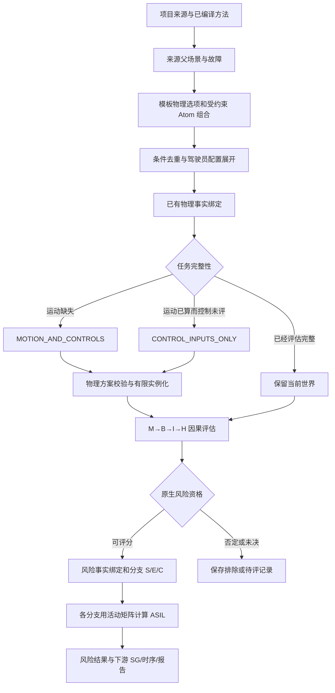

# 03　场景物理与风险计算

[返回交接总览](README.md)

本文面向接手生成、物理计算和风险评分代码的工程师，核对基线为 `d6a400e`。重点是普通 `analyze` 如何把项目条件变成可追溯的物理世界，再计算同一世界的 S/E/C/ASIL。文中的类和方法是定位入口；方法等级、数值边界和适用性仍以本次运行实际编译的 `MethodContract` 为准。仓库的 `output/` 重放脚本与历史报告是证据，不是第二套生产实现。权威约束见 [AGENTS.md](../../AGENTS.md)，运行契约见 [MethodContract](../../src/hara_agent/contracts/method_contract.py)。

## 1. 先区分四种权威和两个“已完成”

| 对象 | 代表什么 | 不能据此推断什么 | 权威入口 |
|---|---|---|---|
| 项目事实 `ItemDefinitionFacts`、`RiskFact` | 来源文档中的范围、功能、接口与带上下文事实 | 项目未给出的故障能力、独立性或动态参数 | [item_facts.py](../../src/hara_agent/models/item_facts.py)、[project_facts.py](../../src/hara_agent/models/project_facts.py) |
| 编译方法 `MethodContract` | 允许的 Atom、规则、分档、矩阵和报告契约 | 模板例子就是本项目事实 | [method_contract.py](../../src/hara_agent/contracts/method_contract.py)、[method_sources](../../src/hara_agent/method_sources) |
| 分析假设 `PhysicalScenarioPlan` | 有依据、有适用条件的代表运动／控制提案 | 实测能力、工程批准或全 ODD 上界 | [physical_scenario_plan.py](../../src/hara_agent/contracts/physical_scenario_plan.py) |
| 派生物理证据 `EvidenceRecord` | 明确输入、方程、对象和时点上的计算结果 | 计算出数值便证明原假设真实 | [scenario_physics.py](../../src/hara_agent/services/analysis/scenario_physics.py)：`derive_scenario_physics` |

`VALIDATED` 可以表示结构、引用和确定性一致性检查通过；`FINALIZED` 也可能只表示因果契约或表查算完成。二者都不自动授予生成假设工程批准。含 LLM 分析谱系的计算可有数值，同时保留 `PENDING`、`calculation_nature=CONDITIONAL`、`engineering_approval=NOT_GRANTED`。不要通过删除这些标记把草案变成已确认车辆能力。来源接受和条件性判定分别看 [scenario_physics.py](../../src/hara_agent/services/analysis/scenario_physics.py) 的 `source_is_accepted_for`、`has_conditional_lineage`，评分传播看 [StructuredRiskScoringService.score](../../src/hara_agent/services/analysis/structured_risk_scoring_service.py)。

当前默认 YAML 基线由 [manifest.yaml](../../method_assets/fusa_baseline_v1/manifest.yaml) 编译。本次只读核对得到 `method-contract-v3`、`yaml-baseline-compiler-v6`、`READY_WITH_WARNINGS`，方法源哈希为 `9e358fc7ac2e5775f7463dbbed131c02e7c22430e84fe37bc9936778c244402b`；C profile 为 `iav_avp_v1`。这些是交接快照，不得写进运行时作为项目识别条件。显式模板和 YAML 最终都进入同一个契约；报告模板哈希与方法哈希独立。解析入口是 [MethodSourceResolver](../../src/hara_agent/method_sources)，基线数字权威列在 manifest 的 `sources`、`policies` 与排除项中；运行时不能直接打开 YAML 选择另一套规则。仓库存在的 `raw/controllability_rules.yaml`、`raw/c_iso26262.yaml` 等被当前 manifest 排除的数字来源，不能重新当成备用评分器。

## 2. 普通生产调用顺序

主编排入口是 [workflow/nodes/scenarios.py](../../src/hara_agent/workflow/nodes/scenarios.py) 的 `assess_scenarios`。它先调用 `MethodScenarioCandidateService.generate_for_malfunction`，随后调用 `construct_physical_scenarios`，再进入 `_assess_instantiated_scenarios` 和风险事实补全。物理提案发生在因果评估之前；不能先给风险数值，再反向生成“能支持这个数值”的轨迹。调用细节见 [method_scenario_service.py](../../src/hara_agent/services/analysis/method_scenario_service.py)、[workflow/physical_analysis.py](../../src/hara_agent/workflow/physical_analysis.py)。

定向重验使用同一个 `assess_scenarios(prepared_candidates_by_malfunction=...)`：只是从已经提交的精确条件开始，不重新生成 Atom，并继续经过普通物理、因果、事实和 checkpoint 路径。它不是绕过资格、预填控制或预填评级的样本后门。参数必须保留真实 MF 作用域，样本限制也不能改变同一世界的语义。代码见 [assess_scenarios](../../src/hara_agent/workflow/nodes/scenarios.py)，对应回归见 [test_p6_scenario_pipeline.py](../../tests/unit/test_p6_scenario_pipeline.py)、[test_qualified_odd_scope.py](../../tests/unit/test_qualified_odd_scope.py)。

## 3. ODD、Atom 与场景数量

### 3.1 从项目范围到受约束组合

项目条件必须先按 `function_id`、`operating_mode` 收窄。`ItemDefinitionFacts.for_scope` 和 `scoped_odd_context` 处理带限定证据的道路、天气等范围；允许某功能在室内运行，不表示所有功能都允许室内。`generate_for_malfunction` 保留原来源审计，再向当前世界投影收窄的权限。入口见 [item_facts.py](../../src/hara_agent/models/item_facts.py)、[MethodScenarioCandidateService.generate_for_malfunction](../../src/hara_agent/services/analysis/method_scenario_service.py)。

场景维度、Atom 和结构约束来自 `method.scenario_model`。`ScenarioMethodService` 先匹配故障机制模板并形成物理选项；`ConstrainedScenarioSynthesisService` 按项目速度范围、坡度、天气、地点、复合 Atom 填充关系等过滤和选择代表组合。它不是全部维度笛卡尔积。未知绑定应保留候选与诊断，不用任意 Atom 填满空格。核心方法为 `candidate_sets`、`hard_filter_decision`、`global_compound_legality`、`generate_candidates`，见 [scenario_synthesis_service.py](../../src/hara_agent/services/analysis/scenario_synthesis_service.py) 和 [ScenarioConstraintExecutor](../../src/hara_agent/services/analysis/scenario_constraint_service.py)。

相同物理选项跨来源环境共同选择代表，随后按结构条件去重，并记录 `equivalence_mapping`、原始父身份和未覆盖组合。来源焦点 `source_condition_focus` 在非驾驶员条件组上稳定分配，再展开驾驶员配置；改变样本选择顺序不应改变同一世界的焦点。来源中的“平行／斜列车位”仍须通过 `operating_condition.physical_effect` 或可选 `layout_relation` 连接到几何、运动或可见性，不能仅换名称便声称覆盖。权威实现见 [method_scenario_service.py](../../src/hara_agent/services/analysis/method_scenario_service.py) 的 `_allocate_source_focus`、[scenario_equivalence.py](../../src/hara_agent/services/analysis/scenario_equivalence.py) 的 `coalesce_candidates`、[physical_scenario_plan.py](../../src/hara_agent/contracts/physical_scenario_plan.py) 的 `_validate_layout_relation`。

### 3.2 必须保留的数量口径

| 层次 | 主要身份／统计 | 为什么与下一层不同 |
|---|---|---|
| 来源父场景 | 原地点、工况和父 ID | 一个父场景可能产生多个物理选项 |
| Atom 代表候选 | `raw_candidate_count`、`unique_condition_count` | 条件去重保留全部映射，未选组合未被评估 |
| 驾驶员世界 | `driver_position` 等条件 | 同一运动可有车内／车外等不同控制世界 |
| 物理方案 | `plan_key`、`plan_requests` | 一个方案可供同条件驾驶员家族使用 |
| 物理实例 | 代表参数点、`generated_instances` | 机制与参数抽样共用有限实例槽 |
| 因果记录 | attempted、retained、pending、excluded | 被生成不等于满足故障因果链 |
| 碰撞分支 | `branch_id`、`impact_time_id` | 一个风险世界可有多个有限对象／接触分支 |
| 风险结果 | MF＋场景＋危险事件关联 | 仅风险资格通过的关联进入评分 |
| 报告记录 | 主表风险与场景详情／历史记录 | 历史排除、未决、合并映射不等于主表风险行 |

上述统计分别由 [MethodScenarioCandidateService](../../src/hara_agent/services/analysis/method_scenario_service.py)、[construct_physical_scenarios](../../src/hara_agent/workflow/physical_analysis.py)、[assess_scenarios](../../src/hara_agent/workflow/nodes/scenarios.py) 和 [ReviewArtifactWriter](../../src/hara_agent/workflow/review_artifacts.py) 记录。评估成本还要区分方案请求、响应缓存命中、确定性求解点和因果请求。不能用 Excel 行数代替场景覆盖，也不能把同一个共享方案算成所有成员都完成了独立因果评估。

## 4. 物理方案、实例化与继承

### 4.1 哪些情况需要模型调用

`PhysicalHypothesisInstantiationService.task_scope` 返回 `MOTION_AND_CONTROLS`、`CONTROL_INPUTS_ONLY` 或空字符串。已有来源有效、评估完整的运动与控制直接复用；已算运动但人工路径等声明遗漏时只补控制。明确 `failed` 或 `unresolved` 也属于已完成的评估，不应每次恢复都再请求。`manual_path_gap` 只检查活动方法所需的声明是否齐全，不强制模型必须宣称人工制动可用。入口见 [physical_hypothesis_instantiation_service.py](../../src/hara_agent/services/analysis/physical_hypothesis_instantiation_service.py)。

`PhysicalScenarioAgent` 只产生契约允许的方案，不决定 S/E/C。运动假设携带 `geometry`、`parameters`、`conditions`、`basis_refs`、`condition_changes`、`failed_controls`、`remaining_controls`、`uncovered_conditions`，并可声明响应和危险时钟；控制补评则使用现有 `control_assessment` 结构。Schema 拒绝未知模型、错误单位和非法字段。具体字段以 `PhysicalScenarioPlan.from_dict`、`MODEL_CATALOG`、`PARAMETER_UNITS` 为准，见 [physical_scenario_plan.py](../../src/hara_agent/contracts/physical_scenario_plan.py) 与 [PhysicalScenarioAgent](../../src/hara_agent/services/semantic/physical_scenario_agent.py)。

### 4.2 不能盲目继承父事实

实例化器的 `_model_inputs`、`_inheritance_reason` 会检查来源、单位、对象、初态／接触时点、作用域和模型是否兼容。原碰撞速度不能当新模型初速，旧目标距离不能供新目标使用；参数同名不表示相同语义。切换初态或目标须显式声明 `condition_changes`；新目标必须有新 `object_id`。父派生速度、TTC、接触阶段会失效重算，原父候选仍保留。来源直接事实与新假设冲突时进入诊断，不能覆盖来源使计算通过。实现见 [PhysicalHypothesisInstantiationService._instantiate](../../src/hara_agent/services/analysis/physical_hypothesis_instantiation_service.py)。

人员同样必须有作用域。已有明确位置优先；仅在保存请求的签名、MF、规范化条件和 `plan_key` 全部匹配，且请求确为唯一驾驶员配置时，才可恢复模型漏列的同一配置。未知、多配置或明确冲突不能默认“在驾驶位”。`controls_for_driver` 可共享执行器能力，但人工、远程和自动命令路径保持人员／响应范围；局部显式失败或未知优先。入口见 [instantiate](../../src/hara_agent/services/analysis/physical_hypothesis_instantiation_service.py)、[controls_for_driver](../../src/hara_agent/contracts/physical_scenario_plan.py)，真实冻结回归见 [test_request_driver_scope.py](../../tests/unit/test_request_driver_scope.py)、[test_saved_personnel_response_scope.py](../../tests/unit/test_saved_personnel_response_scope.py)。

### 4.3 点、范围和符号是不同输入

`POINT` 是一个条件性值；`RANGE` 保存上下界与代表值；`SYMBOLIC` 必须有符号及无法量化的理由。实例化器 `_samples` 从代表点和单因素方法边界附近取样，不做多维全排列。当前 `MAX_INSTANCES_PER_PLAN=3`，机制假设与参数点共享这些实例槽。超出槽位的边界放在 `sensitivity.deferred_points`，并明确 `range_invariance_proven=False`、`vehicle_upper_bound_proven=False`。符号输入保留 `parameter_relations`，不凭默认加速度或距离造数值。权威代码见 [physical_hypothesis_instantiation_service.py](../../src/hara_agent/services/analysis/physical_hypothesis_instantiation_service.py) 的 `_samples`、`boundaries`、`parameter_relations`。

## 5. 坐标、单位与当前模型

### 5.1 先确认坐标，再读公式

固定初始车体坐标采用 `BODY_FORWARD_POSITIVE`：`+x` 朝车头、`+y` 朝左，目标中心偏移有正负号。`ego_heading_angle_deg`、`object_heading_angle_deg` 是从 `+x` 向 `+y` 计的恒定**速度方向**，不是方向盘角或车轮角。速度幅值使用 km/h，内部除以3.6转 m/s；加速度 m/s²、距离 m、时间 s、坡度百分比。包络半长／半宽是双方投影半尺寸之和，不是任意指定的单车尺寸。入口见 [MODEL_CATALOG／PARAMETER_UNITS](../../src/hara_agent/contracts/physical_scenario_plan.py)、[scenario_physics._heading_vector](../../src/hara_agent/services/analysis/scenario_physics.py)。

`relative_distance_m` 在静止目标沿程模型中表示至首次表面接触的剩余行程，不是中心间距。坡度百分比也不是角度；`grade_frame` 还须说明朝向、下坡方向及来源，重力方向由朝向映射，阻力只抵消运动，不能凭阻力把车启动到上坡。`layout_relation` 的车位轴／通道轴是无方向轴关系，另由路径声明连接到初始速度方向，不能混作转向动力学。实现见 [physical_scenario_plan.py](../../src/hara_agent/contracts/physical_scenario_plan.py) 的布局和坡度校验，以及 [scenario_physics.derive_scenario_physics](../../src/hara_agent/services/analysis/scenario_physics.py)。

### 5.2 模型目录与方程范围

下表是现有物理 API 的解释，非新规则。增加模型必须同时修改契约、实例化校验、求解器和受影响消费者；只在提示词中加一个名称不会获得支持。权威目录是 [physical_scenario_plan.MODEL_CATALOG](../../src/hara_agent/contracts/physical_scenario_plan.py)，实际计算集中在 [scenario_physics.py](../../src/hara_agent/services/analysis/scenario_physics.py)。

| 模型 | 核心关系与所需条件 | 主要边界 |
|---|---|---|
| `CONSTANT_ACCELERATION_TO_IMPACT_DISTANCE` | 沿声明方向直行到静止目标；`d=v₀t+at²/2`、`v²=v₀²+2ad`；初速、净加速度和接触行程有依据 | 选停止前首次非负接触；可显式声明独立剩余限速，按加速／限速阶段求解，不能把正常 ODD 最高车速当故障限速 |
| `GRADE_ROLLAWAY_TO_IMPACT_DISTANCE` | 初始静止、恒坡、静止目标；`a=max(0,g·sin(atan(p/100))−r)`，随后用沿程方程 | 坡度和残余阻力必须有条件依据；阻力足够时不启动；目标不在下坡路径不能靠补参数强行碰撞 |
| `CONSTANT_LATERAL_ACCELERATION_TO_CONTACT` | 惯性 x/y 独立平移；x恒速，`w=v_y0·t+a_y·t²/2`，接触合速度由 x/y 分量合成 | 用于明确侧滑／漂移机制，不能把正常转弯法向加速度直接当独立横移；目标须为沿行驶方向延伸的静止侧边界；不派生纵向 TTC |
| `CONSTANT_SPEED_CURVATURE_TO_CONTACT` | 恒速、无侧滑圆弧；`θ=vt/R`、`y=R(1−cosθ)`、`a_n=v²/R`，取转向一侧首次边界接触 | 限声明时域和首个四分之一圆；不是“纵向速度不变再叠加横向速度”；半径不是实测转向／附着能力 |
| `RECTILINEAR_MOVING_TARGET_CONTACT` | 固定速度方向与轴对齐有限包络；`r(t)=offset+û·s_target(t)−v̂·s_ego(t)`，各段 `s=v₀Δt+aΔt²/2`；首次同时满足 `abs(x)≤hx` 与 `abs(y)≤hy` | 自车固定方向恒加速度，目标恒速或显式反应后制动至停；停止不反向；可声明停止保持；不支持改变航向、任意目标加速或旋转车体包络 |

直线移动接触模型还可携带 `grade_frame`：自车必须从静止开始，用坡度和残余阻力替代独立加速度，并核对重力方向与车体方向；目标仍使用同一有限分段轨迹。`post_stop_motion=HOLD_POSITION` 则让自车停车后保持到声明时域，继续检查目标是否随后进入包络，不能在自车停下时便宣布整个时域安全。相关入口是 [scenario_physics._straight_world／derive_scenario_physics](../../src/hara_agent/services/analysis/scenario_physics.py) 和 [PhysicalScenarioPlan](../../src/hara_agent/contracts/physical_scenario_plan.py)。

圆弧模型还可成对提供 `object_offset_x_m` 与 `contact_half_length_m`，核对接触点 x 是否落在固定有效纵向区间内。不提供时，结果依赖延展侧边界覆盖该点的假设；提供而落在区间外时返回模型几何不适用，不代表车辆不可能在别处相撞。这仍是有效接触区间近似，不是完整旋转车体检测。入口为 [constant_speed_curved_contact](../../src/hara_agent/services/analysis/scenario_physics.py)，回归见 [test_curved_steering_physics.py](../../tests/unit/test_curved_steering_physics.py)。

目录以外，已有治理方法可通过 `representative_motion_rules` 产生 `CONSTANT_SPEED_REPRESENTATIVE`。这条路径只在所选模板、故障类型、模式和来源输入符合已编译规则时生效；不是 LLM 可随意请求的第六个运动模型，也不能在已有物理假设上重新套模板默认值。权威实现是 [AnalyticalPhysicsInstantiationService.produce_inputs](../../src/hara_agent/services/analysis/analytical_physics_instantiation_service.py)，规则源为 [project_analysis_policy.yaml](../../method_assets/fusa_baseline_v1/normalized/project_analysis_policy.yaml)。

### 5.3 接触时间、TTC、零速度与无接触

`first_contact_time_s` 表示当前轨迹的首次包络重合时间。只有模型证明实际运动轴满足纵向条件时才派生 `ttc_s`；`SIDE` 只是接触表面标签，不能单独认定轨迹横穿。反过来，有横向位移的交叉接触不能拿接触时间冒充纵向 TTC。`target_is_stationary_in_model` 用来源有效的模型及完整分段零速度／零加速度证明目标恒静止，此时 `0×RIGHT` 仍是零向量；保留原方向标签，只在计算视图中使用静止方向。初速为零但随后侧移不满足该证明。入口见 [rectilinear_moving_contact](../../src/hara_agent/services/analysis/scenario_physics.py)、[StructuredRiskScoringService._score](../../src/hara_agent/services/analysis/structured_risk_scoring_service.py)，回归见 [test_longitudinal_surface_cache.py](../../tests/unit/test_longitudinal_surface_cache.py)、[test_zero_target_velocity_direction.py](../../tests/unit/test_zero_target_velocity_direction.py)。

`CONTACT`、`STOPPED_BEFORE_CONTACT`、`NO_CONTACT_WITHIN_MODEL`、`MODEL_GEOMETRY_NOT_APPLICABLE`、`MODEL_INPUTS_UNRESOLVED` 必须分别解释。有限时域内无接触不是全场景无危险；几何近似不适用不是安全证明；符号／缺输入不是零速度、零距离、S0或C0。已有环境 E 可能独立可算，不应因 S/C 缺值一并删除。具体状态和证据由 [derive_scenario_physics](../../src/hara_agent/services/analysis/scenario_physics.py)、[StructuredRiskScoringService](../../src/hara_agent/services/analysis/structured_risk_scoring_service.py) 和 [HazardousEventRiskContextService](../../src/hara_agent/services/analysis/hazardous_event_risk_context_service.py) 共同保留。

## 6. 因果资格：运动算得出，不代表故障导致该运动

因果链为 M（故障）→B（功能／车辆行为）→I（物理交互）→H（危险结果）。每一跳须引用当前来源或派生证据。已有接触解最多支持交互／危险阶段，不能倒推故障必然产生所列加速度或 t0 即固定曲率。当前因果 Agent 明确按未施加避险响应的世界评估；`remaining_controls` 或 Safe-State 提案不证明已检测、已请求、必触发，不能据此否定危险。若原轨迹本来已经包含制动、保持或目标反应，则必须保留该真实阶段，不能删掉它来制造接触。入口见 [ScenarioFeasibilityAgent.SYSTEM_PROMPT](../../src/hara_agent/services/semantic/scenario_agent.py)、[scenario_batching.py](../../src/hara_agent/services/semantic/scenario_batching.py)，回归见 [test_unmitigated_causal_boundary.py](../../tests/unit/test_unmitigated_causal_boundary.py)。

只有 `evaluate_risk_eligibility_payload` 与有效 `ScenarioCausalAssessment` 共同满足资格的关联进入评分。否定、引用错误、断点未决分别保存，不能只看“有一个 assessment”或 `final_retain` 字面字段。因果契约的 FINALIZED 与场景假设的 PENDING 可以同时存在。需要有界纠正时复用 Agent 的 `_repair_single_item_contract` 及既有错误类型，不新增无限重试或把希望的 true/评级写入反馈。代码见 [models/scenario.py](../../src/hara_agent/models/scenario.py)、[scenario_causal_assessment.py](../../src/hara_agent/contracts/scenario_causal_assessment.py)、[scenario_agent.py](../../src/hara_agent/services/semantic/scenario_agent.py)。

## 7. S/E/C 与分支 ASIL 的实际边界

### 7.1 同一个危险事件风险上下文

`score_structured_scenarios` 先绑定方法与项目事实、产生或核验中立物理量，再由 `HazardousEventRiskContextService.build` 形成同一 MF／场景／危险事件的上下文。`RiskCalculationInputService` 把上下文转换为 S、E、C、FTTI 输入；它不持有等级表。直接调用 `StructuredRiskScoringService.score` 也要经过当前物理视图和控制适用性检查，离线重放不能借旧 true 绕过。入口见 [workflow/nodes/scoring.py](../../src/hara_agent/workflow/nodes/scoring.py)、[risk_calculation_input_service.py](../../src/hara_agent/services/analysis/risk_calculation_input_service.py)。

### 7.2 S：先选合法速度语义，再查表

S 的数字输入可能是相对速度、Δv、冲击速度或本车速度，但只能使用活动方法确认的语义。当前 manifest 声明相对速度主方法和交通域后备政策；**后备尚未编译为可执行契约**，编译诊断为 `SEVERITY_FALLBACK_UNCOMPILED`，缺相对速度时不能切到本车速度或交通域补 S。`SeverityDeltaVSemanticAuditService.input_authority` 检查来源、派生授权和语义冲突，`SeverityMethodExecutor` 按道路使用者组、碰撞类型及边界查表。若活动方法要求 Δv，没有批准转换时，已有相对速度也不能冒充 Δv。入口见 [severity_delta_v_semantic_audit_service.py](../../src/hara_agent/services/analysis/severity_delta_v_semantic_audit_service.py)、[deterministic_risk_executor.py](../../src/hara_agent/services/analysis/deterministic_risk_executor.py)、[yaml_baseline.py](../../src/hara_agent/method_sources/yaml_baseline.py)，数值源见 [severity_table.yaml](../../method_assets/fusa_baseline_v1/raw/severity_table.yaml) 与 [severity_semantics.yaml](../../method_assets/fusa_baseline_v1/normalized/severity_semantics.yaml)。

### 7.3 E：项目／场景语义绑定与组合策略

E 使用编译的 Atom、功能／组件适用域和组合关系，不是 LLM 对“常见程度”的自由打分。`ExposureDimensionCoverageService.decide` 给出维度覆盖诊断；`ExposureInputReadinessService.assess` 检查绑定可用性；`ExposureMethodExecutor` 与 `ExposureCombinationExecutor` 执行当前策略。默认 `fusa_v1` 的覆盖诊断并非额外强加的新评分门，实际结果仍按其编译语义决定。全高、混高、异级、同级依赖等分支的数值以治理策略为准，不能在修诊断时另造一套 E 算法。入口见 [exposure_dimension_coverage_service.py](../../src/hara_agent/services/analysis/exposure_dimension_coverage_service.py)、[exposure_input_readiness_service.py](../../src/hara_agent/services/analysis/exposure_input_readiness_service.py)、[exposure_policy.yaml](../../method_assets/fusa_baseline_v1/normalized/exposure_policy.yaml)。

### 7.4 C：能力、适用范围和查表是三道检查

当前 C 先由活动方法执行 override／三态条件判断与 profile 查算，再核对有来源的条件性参考规则和运动适用性。TTC 有数值并不绕过这些条件。横穿、曲率、后方接近、停住后被目标撞上、全轨迹静止等世界，各自可能没有适用的制动时窗规则；应保留接触结果及具体 Pending 原因。参考规则来自 `method.metadata.project_analysis_policy.controllability.conditional_reference_rules`，包括必需控制、速度严格上界、函数输出和遮挡／迟发现排除条件；不修改数值精度来跨过方法边界。入口见 [StructuredRiskScoringService._score／_conditional_reference_control](../../src/hara_agent/services/analysis/structured_risk_scoring_service.py)、[StructuredControllabilityExecutor](../../src/hara_agent/services/analysis/deterministic_risk_executor.py)、[iav_avp.yaml](../../method_assets/fusa_baseline_v1/raw/c_profiles/iav_avp.yaml)。

排除条件的正则由治理 YAML 提供，执行器仅在当前有效假设的 `conditions` 和 `operating_condition.physical_effect` 中检查局部语句。否定、未覆盖范围、转折后的实际遮挡不能混为一谈。例如“不据此声明遮挡”不是当前已遮挡，而“道路无遮挡，但停放车辆遮挡行人”仍存在实际遮挡。改这里应同时保留正／反／混合句回归，不按项目 ID 或固定报告句子做白名单。来源见 [project_analysis_policy.yaml](../../method_assets/fusa_baseline_v1/normalized/project_analysis_policy.yaml)，执行与回归见 [structured_risk_scoring_service.py](../../src/hara_agent/services/analysis/structured_risk_scoring_service.py)、[test_c_response_applicability.py](../../tests/unit/test_c_response_applicability.py)。

### 7.5 分支必须使用各自完整元组

`collision_branches` 是有对象、机制和接触时点的有限物理成员。`branch_physics_view` 在对象、方向、几何、速度、来源或阶段变化后失效父派生量；`None` 可显式清除分支输入。分支换对象时也不能借用父 OBJECT 的 E 绑定。相对速度范围的 S 表分区不证明 C 对整个区间不变。每条分支先算自己的 S/E/C，再经当前矩阵得 ASIL；不能拼接某分支最大 S 与另一分支最好 C。入口见 [scenario_physics.branch_physics_view](../../src/hara_agent/services/analysis/scenario_physics.py)、[StructuredRiskScoringService._score_collision_branches](../../src/hara_agent/services/analysis/structured_risk_scoring_service.py)。

顶层结果保留一个真实决定分支的元组和 `highest_known_asil`；没有完整结果时保留实际 partial 分支或独立可算 E，不从父世界重算以补出不存在的 S/C。仍有未决分支时，已知最高 ASIL 不等于车辆上界。所有 ASIL 只经 `MethodContractASILService` 查询 `method.asil`；未知不是零，只有活动矩阵支持的已知维度短路才可产生部分输入结果。入口见 [asil_service.py](../../src/hara_agent/services/analysis/asil_service.py)、[structured_risk_scoring_service.py](../../src/hara_agent/services/analysis/structured_risk_scoring_service.py)，回归见 [test_controllability_branch_audit.py](../../tests/unit/test_controllability_branch_audit.py)、[test_structured_risk_scoring.py](../../tests/unit/test_structured_risk_scoring.py)。

## 8. 控制路径不能合并为一个 braking 布尔量

| 身份／状态 | 含义和消费者 | 不允许的替代 |
|---|---|---|
| `braking`、`drive`、`steering` | 执行器／执行能力 | 执行器完整不等于命令可达 |
| `driver_braking` | 当前驾驶员踏板路径，供人工 C 适用性 | 不由通用 braking、人在车内推导 |
| `automatic_*_command` | 指定系统命令通道 | 故障输出不能被共享能力恢复 |
| `remote_control` | 当前范围的远程响应路径 | 不能借车内踏板或仅凭远程界面给避碰收益 |
| `remaining / failed / unresolved` | 条件性可用／明确失效／未知三态 | 未知不能写成失效，也不能默认可用 |

控制身份、依赖与人员投影由 [physical_scenario_plan.py](../../src/hara_agent/contracts/physical_scenario_plan.py) 的 `CONTROL_IDENTITIES`、`controls_for_driver` 管理。人工三态检查是 [RiskCalculationInputService.manual_braking_applicability](../../src/hara_agent/services/analysis/risk_calculation_input_service.py)：明确失效在 C 查算副本中为 False，未评估／未知为 None；原执行器 True 保留给自动响应计算。因此人工不可用、自动 FTTI 可算可以同时成立，报告原因必须区分两条通道。

远程正向 C 收益还需要同轨迹响应提案、明确延迟与已计算正窗口。其他道路使用者避让同样必须有当前 MF／场景范围内的分析来源，再用 `moving_target_avoidance` 检查识别时间、净空及有限运动过渡。不能瞬时反向；减速、加速、停住重定向须有参数，跨轴转弯缺模型时拒绝收益。一般能力事实不能替代当前轨迹提案的来源范围。入口见 [remote_intervention_applicability／road_user_avoidance_applicability](../../src/hara_agent/services/analysis/risk_calculation_input_service.py)、[moving_target_avoidance](../../src/hara_agent/services/analysis/scenario_physics.py)，回归见 [test_scoped_timing_and_avoidance.py](../../tests/unit/test_scoped_timing_and_avoidance.py)。

Safe-State／FTTI 的接点是同一假设中的 `safe_state_proposal`、`required_controls`、`transition` 和 `hazard_timing`。它们不修改未缓解轨迹，也不自动降低 C；响应必须在当前剩余控制中成立，故障时钟和模型起点须明确。当前时序执行器计算所声明响应的可避碰边界，不执行“接触时间＋接触后停车时间”来冒充 FTTI。响应负面、缺命令、缺时钟分别保留；历史撤回提案只在严格同源条件下重验，不复活失败能力。详细入口是 [RiskCalculationInputService.ftti](../../src/hara_agent/services/analysis/risk_calculation_input_service.py)、[FTTIMethodExecutor](../../src/hara_agent/services/analysis/deterministic_risk_executor.py)、[workflow.physical_analysis._retain_rejected_response](../../src/hara_agent/workflow/physical_analysis.py)；完整时序职责应结合相邻交接文档阅读。

## 9. 业务复用与缓存：复用什么，失效什么

物理层先用 `_physical_families` 按任务类型和规范化物理条件归组，已知驾驶员配置可共享同一未缓解运动方案，但成员控制、因果和风险仍各自求值。`plan_key` 的输入包括条件、MF／功能、作用域项目上下文、方法／策略、模型目录身份、生产契约版本、提示版本和模型路由。相同文字 ID 不等于相同条件；也不能只因项目名相同便共享计划。入口见 [construct_physical_scenarios](../../src/hara_agent/workflow/physical_analysis.py)、[PhysicalHypothesisInstantiationService.physical_conditions](../../src/hara_agent/services/analysis/physical_hypothesis_instantiation_service.py)。

保存的 `physical_analysis_plans` 包含 context、原计划／响应、校验版本、实例化和有界纠正记录。响应校验版本变化可先重验旧响应；合法旧方案不必重新付费。提示语义、目录或请求输入确有改变时，要通过实际身份隔离，不能伪造旧 key。当前版本常量位于 [PhysicalScenarioAgent](../../src/hara_agent/services/semantic/physical_scenario_agent.py)：运动 v61、控制 v40、因果 v34 位于 [ScenarioFeasibilityAgent](../../src/hara_agent/services/semantic/scenario_agent.py)；计划契约仍是 [PHYSICAL_PLAN_VERSION](../../src/hara_agent/contracts/physical_scenario_plan.py) 的 v6，恢复行为应看版本和保存内容共同验证，不能只比版本号。

因果 `exact_task_key` 包含当前结构条件、来源、方法、提示／契约和项目证据。普通 key、请求序列化和解析均使用同一 `scenario_with_current_physics` 视图：当前只对保存的直线移动接触计算缓存作窄范围刷新；无变化返回原候选，直接事实冲突报错，同值直接来源仍保留原权威。不能让 key 看新 TTC、请求正文却引用旧布尔量，也不能把所有旧 DERIVED 都无条件当成可覆盖缓存。入口见 [scenario_equivalence.py](../../src/hara_agent/services/analysis/scenario_equivalence.py)、[HazardousEventRiskContextService._scenario_with_derived_physics](../../src/hara_agent/services/analysis/hazardous_event_risk_context_service.py)、[scenario_batching._scenario_json](../../src/hara_agent/services/semantic/scenario_batching.py)。

驾驶员间复用因果不是复制批准：`driver_reuse_proof` 检查真实依赖、人员差异及引用，`rebind_assessment_payload` 只重绑身份，再由正常 parser 校验。模型实际写了“纵向接触=false”等已改变事实时，应失效相应任务并重新判断，不能因为接触数值没变就免费重绑字面相反的结论。历史记录保留，最新合格结果按过程替代，不能按评级高低挑选。代码见 [scenario_equivalence.py](../../src/hara_agent/services/analysis/scenario_equivalence.py)、[workflow/nodes/scenarios.py](../../src/hara_agent/workflow/nodes/scenarios.py)，缓存回归见 [test_scenario_incremental_checkpoint.py](../../tests/unit/test_scenario_incremental_checkpoint.py)、[test_scenario_checkpoint_contract.py](../../tests/unit/test_scenario_checkpoint_contract.py)。

## 10. 接手时可直接复现的典型案例

1. **侧面标签、真实纵向运动。** 自车沿初始 x 轴前移，静止目标与本车 y 包络已重叠，首次 x 包络接触可属于纵向运动，即使 `collision_type=SIDE`。反例为有非零横向运动分量的同类标签，仍不得用纵向 TTC。看 [test_longitudinal_surface_cache.py](../../tests/unit/test_longitudinal_surface_cache.py)、[test_report_current_physics_view.py](../../tests/unit/test_report_current_physics_view.py)。
2. **零目标速度附 RIGHT 标签。** 整条已接受分段目标轨迹为零时保留 raw RIGHT，但计算副本可用既有零速度静止推导，避免错误清空相对速度、S和C。换成初始零后加速侧移、不同对象或不同来源阶段，证明即不成立。看 [test_zero_target_velocity_direction.py](../../tests/unit/test_zero_target_velocity_direction.py)。
3. **仅制动执行器保留。** 故障后 `braking` 可用但 `driver_braking` 未评估时，普通恢复仅补控制；明确 unknown 后不再循环请求。若人工明确失效而自动命令和执行器保留，C使用人工 False，自动响应仍由自身依赖计算。看 [test_c_response_applicability.py](../../tests/unit/test_c_response_applicability.py)、[test_control_proposals.py](../../tests/unit/test_control_proposals.py)。
4. **报警故障与自动制动。** 可用自动制动不证明故障已检测且必然触发，不能据此否定未缓解危险；但真实运动模型已含制动时也不能删去。看 [test_unmitigated_causal_boundary.py](../../tests/unit/test_unmitigated_causal_boundary.py)。
5. **共享方案恢复单一驾驶位。** 只在签名请求／MF／条件全等时恢复漏列的驾驶位，继承同范围可用响应；篡改配置而沿用原 plan_key、跨场景提案和局部 timing gap 都不能借用。看 [test_request_driver_scope.py](../../tests/unit/test_request_driver_scope.py)、[test_saved_personnel_response_scope.py](../../tests/unit/test_saved_personnel_response_scope.py)、[test_response_evidence_reuse.py](../../tests/unit/test_response_evidence_reuse.py)。

## 11. 改动定位、限制与验收导航

| 问题表现 | 首先修改／检查的原职责 | 最少应覆盖的回归 |
|---|---|---|
| 项目 ODD被错扩到别的功能／模式 | [item_facts.py](../../src/hara_agent/models/item_facts.py)、[method_scenario_service.py](../../src/hara_agent/services/analysis/method_scenario_service.py) | [test_qualified_odd_scope.py](../../tests/unit/test_qualified_odd_scope.py) |
| Atom组合、去重或来源父范围丢失 | [scenario_synthesis_service.py](../../src/hara_agent/services/analysis/scenario_synthesis_service.py)、[scenario_equivalence.py](../../src/hara_agent/services/analysis/scenario_equivalence.py) | [test_scenario_synthesis.py](../../tests/unit/test_scenario_synthesis.py)、[test_scenario_coverage_governance.py](../../tests/unit/test_scenario_coverage_governance.py) |
| 模型／坐标／单位错误 | [physical_scenario_plan.py](../../src/hara_agent/contracts/physical_scenario_plan.py)、[scenario_physics.py](../../src/hara_agent/services/analysis/scenario_physics.py) | [test_bounded_interaction_coverage.py](../../tests/unit/test_bounded_interaction_coverage.py)、[test_curved_steering_physics.py](../../tests/unit/test_curved_steering_physics.py) |
| 继承旧阶段、对象、人员或控制 | [physical_hypothesis_instantiation_service.py](../../src/hara_agent/services/analysis/physical_hypothesis_instantiation_service.py) | [test_physical_causal_input_review.py](../../tests/unit/test_physical_causal_input_review.py)、[test_request_driver_scope.py](../../tests/unit/test_request_driver_scope.py) |
| 可解析但因果阶段错误 | [scenario_agent.py](../../src/hara_agent/services/semantic/scenario_agent.py)、[scenario_evidence.py](../../src/hara_agent/services/semantic/scenario_evidence.py) | [test_unmitigated_causal_boundary.py](../../tests/unit/test_unmitigated_causal_boundary.py)、[test_scenario_evidence_errors.py](../../tests/unit/test_scenario_evidence_errors.py) |
| S/E/C适用性或分支接线错误 | [risk_calculation_input_service.py](../../src/hara_agent/services/analysis/risk_calculation_input_service.py)、[structured_risk_scoring_service.py](../../src/hara_agent/services/analysis/structured_risk_scoring_service.py) | [test_hazardous_event_risk_context.py](../../tests/unit/test_hazardous_event_risk_context.py)、[test_structured_risk_scoring.py](../../tests/unit/test_structured_risk_scoring.py)、[test_c_response_applicability.py](../../tests/unit/test_c_response_applicability.py) |
| 真正要改等级、分档、参考适用性 | 方法资产与对应编译器，再检查 MethodContract | [test_yaml_baseline_compiler.py](../../tests/unit/test_yaml_baseline_compiler.py)、[test_fusa_v1_exposure_parity.py](../../tests/unit/test_fusa_v1_exposure_parity.py) |
| 诊断与报告仍显示旧物理 | [projection.py](../../src/hara_agent/services/reporting/projection.py)、[engineering_text_mapper.py](../../src/hara_agent/services/reporting/engineering_text_mapper.py) | [test_report_current_physics_view.py](../../tests/unit/test_report_current_physics_view.py)、[test_risk_execution_trace.py](../../tests/unit/test_risk_execution_trace.py) |

目前模型不覆盖任意目标转向／加速、时变方向、完整车辆旋转包络、任意响应策略或所有 ODD 连续极值。某个控制路径有依据，也不表示当前 C 方法覆盖其接触阶段；明确缺控制、来源范围不符、真遮挡、严格速度边界、无接触和缺模型必须分别报告。扩展这些能力应先找现有契约和求解器的职责边界，增加有物理／方法依据的条件与反例；不能新增默认能力、把 Pending 批量写 C，或借用其他对象／驾驶员的结论。范围权威见 [MODEL_CATALOG](../../src/hara_agent/contracts/physical_scenario_plan.py)、[project_analysis_policy.yaml](../../method_assets/fusa_baseline_v1/normalized/project_analysis_policy.yaml)、[StructuredRiskScoringService](../../src/hara_agent/services/analysis/structured_risk_scoring_service.py)。

验收要同时检查数值、来源／批准、对象／阶段／坐标、旧新身份、排除、分支元组、SG关联以及请求／缓存恢复。物理修复应增加同世界正反例，必要时用固定 checkpoint 零 Provider 经过普通评分→SG→质量门→原 renderer 重导，保留历史结果；单元通过不能代替生产路径证据。交付仍须执行 AGENTS 要求的完整 pytest、compileall、diffcheck 和活动方法／模板 doctor；任何真实 Provider 验证另需当前明确授权。规则见 [AGENTS.md](../../AGENTS.md)，离线复算入口为 [workflow/risk_rescoring.py](../../src/hara_agent/workflow/risk_rescoring.py)，报告入口为 [services/reporting](../../src/hara_agent/services/reporting)。
